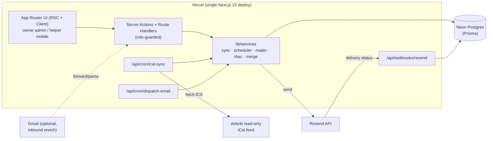

# Implementation Plan: NestRest — Self-Hosted STR Management (v1)

## Stack decisions (LOCKED — justification only)
| Concern | Choice | Why |
|---|---|---|
| Framework | Next.js 15 App Router + TypeScript | One deploy covers UI, server actions, API routes, and cron handlers. Single Vercel project. |
| UI | Tailwind CSS + shadcn/ui | Accessible primitives (WCAG AA), no runtime lock-in, copy-in components. |
| DB | Neon serverless Postgres | Free tier, HTTP/pooled driver friendly to serverless, strong relational fit (see ADR-001). |
| ORM | Prisma | Typed schema, migrations, works with Neon via `@prisma/adapter-neon` or `DIRECT_URL`. |
| Auth | Auth.js (NextAuth) v5 | Magic-link primary + Google optional; DB sessions; role in session. |
| Email | Resend + React Email | Transactional sends, webhooks for delivery status, free tier. |
| Scheduler | Vercel Cron | Free, no extra infra; drives both iCal sync and the email engine (see §4). |
| Testing | Vitest (unit/service) + Playwright (calendar/role e2e) | Fast unit loop; Playwright for keyboard/calendar a11y and role gating. |

> Note: spec §103 mentions Docker Compose self-host. The LOCKED stack targets a single **Vercel** deploy + Neon. Treating Vercel as the canonical deploy; Docker Compose is deferred (noted in Out of scope). ADR-001 records this.

## High-level architecture



Vercel Cron triggers two handlers on schedule; both are thin HTTP endpoints that call service functions. All DB access goes through Prisma. Every service call is property-scoped.

## Prisma schema proposal
File: `prisma/schema.prisma`. Postgres enums used throughout. **Every domain table carries `propertyId`.**

```prisma
enum Role { OWNER HELPER }
enum BookingSource { AIRBNB MANUAL OTHER }
enum BookingStatus { CONFIRMED CANCELLED COMPLETED }
enum BlockReason { MAINTENANCE PERSONAL OTHER }
enum TaskStatus { TODO IN_PROGRESS DONE }
enum ScheduleAnchor { CHECKIN CHECKOUT }
enum ScheduleOffsetDir { BEFORE AFTER }
enum MessageState { PENDING SKIPPED SENT DELIVERED BOUNCED FAILED }
enum ActivityType { SYNC_CREATED SYNC_UPDATED SYNC_CANCELLED EDITED EMAIL_SENT EMAIL_STATUS TASK_CREATED TASK_UPDATED ENRICHED NOTE }

model Property {
  id        String   @id @default(cuid())
  name      String
  address   String      // access/address shown to helpers
  timezone  String      // IANA, e.g. "America/Los_Angeles"
  icalUrl   String?     // ENCRYPTED at rest (app-layer)
  wifiInfo  String?
  doorCode  String?     // ENCRYPTED
  lastSyncAt   DateTime?
  lastSyncError String?
  createdAt DateTime @default(now())
  users         UserProperty[]
  bookings      Booking[]
  guests        Guest[]
  blocks        CalendarBlock[]
  templates     MessageTemplate[]
  scheduledMessages ScheduledMessage[]
  tasks         CleaningTask[]
  activities    ActivityLog[]
}

model User {
  id        String  @id @default(cuid())
  email     String  @unique
  name      String?
  passwordHash String?   // argon2 for helper password path; null for magic-link only
  role      Role    @default(OWNER)
  emailVerified DateTime?
  createdAt DateTime @default(now())
  properties UserProperty[]
  assignedTasks CleaningTask[] @relation("assignee")
  accounts  Account[]
  sessions  Session[]
}

// join table => multi-property-ready; role could later be per-property
model UserProperty {
  userId     String
  propertyId String
  role       Role
  user       User     @relation(fields: [userId], references: [id], onDelete: Cascade)
  property   Property @relation(fields: [propertyId], references: [id], onDelete: Cascade)
  @@id([userId, propertyId])
}

model Guest {
  id         String  @id @default(cuid())
  propertyId String
  firstName  String?       // ENCRYPTED (PII)
  lastName   String?       // ENCRYPTED (PII)
  email      String?       // ENCRYPTED (PII)
  phone      String?       // ENCRYPTED (PII)
  notes      String?       // ENCRYPTED (PII)
  property   Property @relation(fields: [propertyId], references: [id])
  bookings   Booking[]
  @@index([propertyId])
}

model Booking {
  id             String        @id @default(cuid())
  propertyId     String
  source         BookingSource
  status         BookingStatus @default(CONFIRMED)
  // Airbnb reservation code parsed from iCal UID/SUMMARY; unique per property
  reservationCode String?
  icalUid        String?       // raw VEVENT UID, the sync match key
  checkIn        DateTime      // date-only semantics, stored at property TZ noon
  checkOut       DateTime
  payout         Decimal?      @db.Decimal(10,2)   // owner-only field
  summary        String?       // Airbnb-provided placeholder/summary
  guestId        String?
  ownerNotes     String?
  lastSyncedAt   DateTime?
  cancelledAt    DateTime?
  createdAt      DateTime @default(now())
  updatedAt      DateTime @updatedAt
  property Property @relation(fields: [propertyId], references: [id])
  guest    Guest?   @relation(fields: [guestId], references: [id])
  tasks    CleaningTask[]
  scheduledMessages ScheduledMessage[]
  activities ActivityLog[]
  @@unique([propertyId, icalUid])
  @@index([propertyId, checkIn])
  @@index([propertyId, status])
}

model CalendarBlock {
  id         String   @id @default(cuid())
  propertyId String
  start      DateTime
  end        DateTime
  reason     BlockReason @default(OTHER)
  note       String?
  property   Property @relation(fields: [propertyId], references: [id])
  @@index([propertyId, start])
}

model MessageTemplate {
  id         String  @id @default(cuid())
  propertyId String
  name       String
  subject    String
  body       String   // contains {{merge_fields}}
  createdAt  DateTime @default(now())
  property   Property @relation(fields: [propertyId], references: [id])
  scheduledMessages ScheduledMessage[]
  @@index([propertyId])
}

// A ScheduledMessage is the per-booking queued instance (a rule applied to a booking).
model ScheduledMessage {
  id          String   @id @default(cuid())
  propertyId  String
  bookingId   String
  templateId  String
  anchor      ScheduleAnchor
  offsetDir   ScheduleOffsetDir
  offsetHours Int                 // e.g. 24 before CHECKIN, 6 after CHECKOUT
  scheduledFor DateTime           // computed; recomputed while state=PENDING
  state       MessageState @default(PENDING)
  sentAt      DateTime?
  resendId    String?
  error       String?
  // idempotency: one send per booking+template
  dedupeKey   String
  createdAt   DateTime @default(now())
  property  Property @relation(fields: [propertyId], references: [id])
  booking   Booking  @relation(fields: [bookingId], references: [id], onDelete: Cascade)
  template  MessageTemplate @relation(fields: [templateId], references: [id])
  @@unique([dedupeKey])            // dedupeKey = `${bookingId}:${templateId}`
  @@index([state, scheduledFor])   // cron query
  @@index([propertyId])
}

model CleaningTask {
  id          String     @id @default(cuid())
  propertyId  String
  bookingId   String?
  assigneeId  String?
  status      TaskStatus @default(TODO)
  dueDate     DateTime
  accessNotes String?
  nextCheckIn DateTime?  // for back-to-back turnover context
  createdAt   DateTime @default(now())
  updatedAt   DateTime @updatedAt
  property  Property @relation(fields: [propertyId], references: [id])
  booking   Booking? @relation(fields: [bookingId], references: [id])
  assignee  User?    @relation("assignee", fields: [assigneeId], references: [id])
  items     ChecklistItem[]
  @@index([propertyId, status])
  @@index([assigneeId])
}

model ChecklistItem {
  id      String  @id @default(cuid())
  taskId  String
  label   String
  done    Boolean @default(false)
  order   Int
  task    CleaningTask @relation(fields: [taskId], references: [id], onDelete: Cascade)
}

model ActivityLog {
  id         String       @id @default(cuid())
  propertyId String
  bookingId  String?
  type       ActivityType
  actorId    String?      // null => system/cron
  message    String       // never store raw guest PII here
  createdAt  DateTime @default(now())
  property   Property @relation(fields: [propertyId], references: [id])
  booking    Booking? @relation(fields: [bookingId], references: [id])
  @@index([bookingId, createdAt])
  @@index([propertyId])
}

// Auth.js adapter models (Account, Session, VerificationToken) added per NextAuth Prisma adapter.
```

**PII fields needing app-layer encryption (AES-256-GCM via `lib/crypto.ts`, key in `ENCRYPTION_KEY`):** `Guest.firstName/lastName/email/phone/notes`, `Property.icalUrl/doorCode`. Store ciphertext; decrypt only in owner-scoped reads. Never log these; `ActivityLog.message` must reference bookings, not raw PII.

## Module / folder structure
```
apps/web/
  app/
    (auth)/signin/page.tsx
    (owner)/
      dashboard/page.tsx
      calendar/page.tsx
      bookings/page.tsx
      bookings/[id]/page.tsx         # detail + timeline
      templates/page.tsx
      settings/page.tsx              # ical url, wifi/door code, schedule rules
      layout.tsx                     # OWNER-only guard
    (helper)/
      tasks/page.tsx
      tasks/[id]/page.tsx            # mobile checklist
      layout.tsx                     # HELPER+OWNER guard
    api/
      cron/ical-sync/route.ts
      cron/dispatch-email/route.ts
      webhooks/resend/route.ts
      auth/[...nextauth]/route.ts
  actions/
    bookings.ts                      # editBooking, createManualBlock, linkGuest
    tasks.ts                         # assignTask, toggleChecklistItem, completeTask
    templates.ts                     # crud + previewRender
    email.ts                         # sendNow, upsertScheduleRule
    invites.ts                       # inviteHelper
  lib/
    db.ts                            # Prisma client singleton
    auth.ts                          # Auth.js config
    rbac.ts                          # requireRole(), scopeToProperty()
    crypto.ts                        # encrypt()/decrypt()
    merge.ts                         # renderTemplate(body, booking) + missing-field detect
    services/
      ical-sync.ts                   # fetch, parse, upsert, cancel-detection
      scheduler.ts                   # computeScheduledFor, recompute, enqueue
      mailer.ts                      # resend send + log
      dashboard.ts                   # occupancy/revenue aggregates
      activity.ts                    # log()
  components/
    calendar/MonthView.tsx WeekView.tsx ConflictWarning.tsx
    bookings/BookingDetail.tsx Timeline.tsx
    tasks/Checklist.tsx
    ui/*                             # shadcn
  emails/
    CheckinInstructions.tsx ReviewRequest.tsx  (React Email)
  prisma/schema.prisma
  vercel.json                        # cron schedules
```

## Design: three trickiest pieces

### (a) iCal sync job
- Trigger: `vercel.json` cron `*/60 * * * *` → `GET /api/cron/ical-sync` (guarded by `CRON_SECRET` header check).
- Flow per property with `icalUrl`:
  1. Fetch with timeout + 1 retry (exponential backoff ~1s/4s). On failure: set `lastSyncError`, keep `lastSyncAt` old, log `SYNC` activity, return 200 (never throw-destroy). UI shows error banner.
  2. Parse with **node-ical** (server-friendly, handles VEVENT + RRULE). Extract `UID`, `DTSTART`, `DTEND`, `SUMMARY`.
  3. **Match key = `icalUid`** (the VEVENT `UID`, stable across Airbnb feed refreshes). `reservationCode` parsed from SUMMARY/URL as secondary/enrichment key for Gmail matching — resolves open question #3: UID is primary, confirmation code is best-effort.
  4. Upsert on `@@unique([propertyId, icalUid])`. **Only sync-owned fields** (checkIn, checkOut, summary, status, lastSyncedAt) are written; owner-edited fields (payout, guestId, ownerNotes, guest PII) are never overwritten — satisfies "edits not overwritten."
  5. Cancellation: collect UIDs present in feed; any CONFIRMED booking whose UID is absent → set `status=CANCELLED`, `cancelledAt=now`, log `SYNC_CANCELLED`. Not hard-deleted.
  6. On checkIn/checkOut change: update booking, then call `scheduler.recompute(bookingId)` and update the open turnover task's `dueDate`.

### (b) Scheduled email engine
- **Rules** live on settings as (template, anchor, offsetDir, offsetHours). When a booking is CONFIRMED (sync or manual), `scheduler.enqueue(booking)` creates one `ScheduledMessage` per rule with `dedupeKey = bookingId:templateId` and `scheduledFor = anchorDate ± offsetHours` computed in property TZ.
- **Recompute:** on date change, update `scheduledFor` for rows still `state=PENDING`. SENT rows are frozen (idempotency preserved).
- **Firing:** cron `*/15 * * * *` → `/api/cron/dispatch-email`. Query `state=PENDING AND scheduledFor <= now`. For each, inside a transaction:
  1. Guard: if no guest email → `state=SKIPPED`, surface as dashboard action item (don't delete).
  2. Render template via `merge.ts`; unresolved field → `state=FAILED` with error, surfaced to owner (blocks send per AC).
  3. Idempotency: the `@@unique(dedupeKey)` plus a conditional update `WHERE state=PENDING` guarantees exactly-once even on overlapping cron runs. Set `state=SENT`, `resendId`, `sentAt`; log `EMAIL_SENT`.
- Delivery status via `/api/webhooks/resend` → update `state` to DELIVERED/BOUNCED, log `EMAIL_STATUS`.
- This resolves open question #1: **Vercel Cron + DB-row queue**, idempotency from the unique dedupeKey + conditional state transition. No external queue needed at this scale.

### (c) Role-based access (server-enforced)
- `lib/rbac.ts`:
  - `requireRole(roles: Role[])` — reads Auth.js session server-side; throws/`forbidden()` if not matched. Called at top of every server action and in `(owner)/layout.tsx` / `(helper)/layout.tsx`.
  - `scopeToProperty(userId)` — returns property IDs the user may touch via `UserProperty`; **all queries filter by these IDs** (resolves open question #5 — property scoping enforced now even with one property).
  - Helper reads use a **projection layer**: task/booking fetches for HELPER omit `payout` and return only guest fields needed for the task (first name, nothing else). Never rely on UI hiding.
- Guest PII never placed in URLs (use booking IDs) or logs.

## Auth approach
- **Primary: magic link** (Resend email provider) for owner — passwordless, fewer secrets. **Google OAuth optional** as a second provider (owner convenience).
- **Helper invite path:** owner creates invite → helper gets magic link → on first sign-in may set a password (`argon2`) for repeat mobile logins. Role assigned = HELPER via `UserProperty`.
- DB sessions (Prisma adapter), session expiry configured; role injected into session callback.

### Env vars
```
DATABASE_URL            # Neon pooled
DIRECT_URL              # Neon direct (migrations)
AUTH_SECRET
AUTH_URL
GOOGLE_CLIENT_ID / GOOGLE_CLIENT_SECRET   # optional
RESEND_API_KEY
RESEND_WEBHOOK_SECRET
ENCRYPTION_KEY          # 32-byte base64 for AES-256-GCM PII
CRON_SECRET             # validates Vercel Cron calls
EMAIL_FROM
```
Managed via Vercel Environment Variables (prod/preview/dev split); `apps/web/.env.local` for local only, never committed. Secrets never in client bundles (no `NEXT_PUBLIC_` for any of the above).

## Phased build order
1. **Scaffold:** Next.js 15 + Tailwind + shadcn, Prisma schema + first migration to Neon, Auth.js magic-link, `(owner)`/`(helper)` guarded layouts, `lib/db/rbac/crypto`. (acceptance: owner signs in, helper 403 on owner routes)
2. **Bookings + calendar read model:** Booking/Block models, calendar month/week with color-coding, manual block w/ conflict warning, booking detail + timeline. (acceptance: manual CRUD + timeline entries)
3. **iCal sync:** service + cron handler, upsert/cancel, error banner + lastSync. (acceptance: feed reservations appear/cancel; edits survive sync)
4. **Email engine:** templates + merge preview, send-now via Resend, schedule rules, dispatch cron, Resend webhook. (acceptance: once-only scheduled send, recompute on date change, missing-email skip)
5. **Turnover tasks:** auto-create on confirm, due-date follows checkout, assignment, mobile checklist projection for helper. (acceptance: helper sees only scoped task fields)
6. **Dashboard:** occupancy/revenue aggregates + action items. (acceptance: P95 < 500ms one-property)
7. **Gmail enrichment (best-effort, last):** deferred shape below.
8. Polish: a11y pass (keyboard calendar), Playwright role/e2e, Vitest service tests.

## Risks & mitigations
| Risk | Mitigation |
|---|---|
| Vercel Cron min granularity / cold starts delay sends | 15-min dispatch tick is fine (sends are hour-relative); idempotent so retries are safe. |
| Airbnb iCal UID instability | UID is primary key but keep `reservationCode` + date fallback for re-match; cancellations are soft, reversible. |
| Serverless + Prisma connection limits on Neon | Use Neon pooled `DATABASE_URL` + Prisma singleton; keep cron handlers short. |
| PII leakage | App-layer encryption, projection layer for helpers, PII banned from logs/URLs/ActivityLog. |
| Duplicate cron fires double-send | `@@unique(dedupeKey)` + conditional `WHERE state=PENDING` update = exactly-once. |
| Timezone bugs in offsets | All anchor math in property IANA TZ via a date lib (Luxon); store UTC. |

## Resolved open questions
1. Scheduler → Vercel Cron + DB-row queue, idempotent via dedupeKey. (resolved)
2. Gmail shape → **deferred to Phase-ish**: prefer dedicated **forwarding address + inbound parse webhook** over OAuth inbox read (less fragile, no token refresh). Noted, not built in v1 core.
3. Matching key → `icalUid` primary; `reservationCode` for email enrichment. (resolved)
4. Occupancy denominator → **available nights = all nights in month minus owner personal/maintenance blocks**; booked nights = Airbnb/confirmed reservation nights. Product rule: blocks reduce the denominator (they are intentionally unavailable, not lost occupancy). (resolved; flag for owner confirmation)
5. property_id scoping → enforced on every query via `scopeToProperty`, single property in UI. (resolved)

## Out of scope (v1)
- Docker Compose self-host (plan targets Vercel+Neon; revisit for true self-host).
- Gmail parsing beyond the deferred design note.
- Multi-channel feeds (VRBO/Booking), P&L, guest CRM, reviews, SMS, AI generation, Airbnb write-back.
